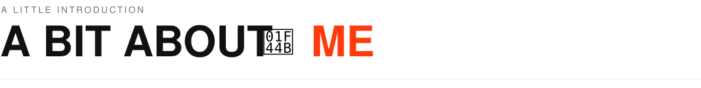
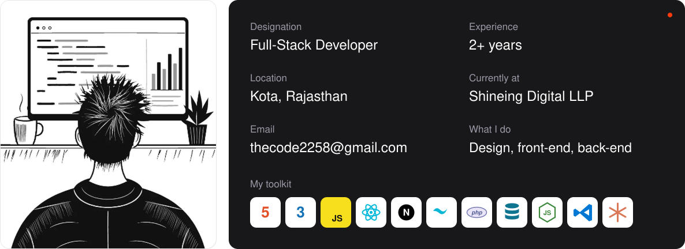

 

Namaste! I'm Amit Bhunia, a **developer who works on both sides of the screen.** I started out on the front end, mostly chasing clean interfaces, until I realized the real work was making the systems behind them hold up.

These days, I enjoy figuring out **what a business actually needs, why it matters, and how to make it simple.** From untangling messy workflows to fussing over the last few pixels, I still care as much about how something feels as how it works.

 

 

- **[project-one](https://github.com/Codurrr11/project-one)**: One line on what it is and why it matters.
- **[project-two](https://github.com/Codurrr11/project-two)**: One line on what it is and why it matters.
- **[project-three](https://github.com/Codurrr11/project-three)**: One line on what it is and why it matters.

 

[Portfolio](https://yourportfolio.com) &nbsp;·&nbsp; [LinkedIn](https://linkedin.com/in/YOUR_USERNAME) &nbsp;·&nbsp; [Email](mailto:thecode2258@gmail.com)

